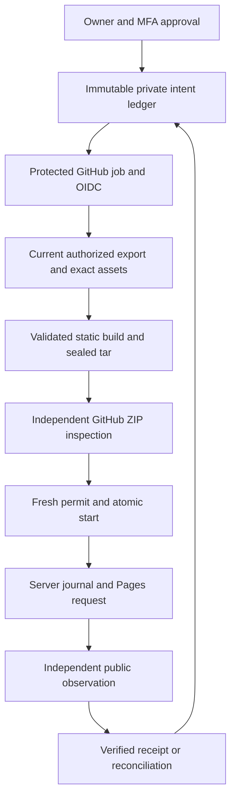

# Nyra Phase 4C — protected delivery integration, prepared only

Baseline: `d4fb25d0f44578c5ea25f35ab8972b75c8ef06b7`. Contract: unchanged `nyra.publication.v1.1`.

**NOT READY FOR PRODUCTION ACTIVATION.** This branch implements and locally exercises composition boundaries. It installs no workflow, endpoint, Edge listener, production migration, bucket, secret, observer schedule or publication trigger. The existing Pages workflow and ordinary `npm run build` stay unchanged in behavior. The proposed workflow files are deliberately outside `.github/workflows`, with the reusable-workflow pin still requiring review. Third-party v4 action references were resolved read-only to exact commits on 2026-10-29.

## End-to-end flow

The existing Phase 2 approval remains the only human editorial authorization. Automation must eventually nudge the protected orchestrator from the held outbox without a second Publish approval. `outbox.mjs` and the service-only nudge ledger claim each actual owner generation durably before requesting the orchestrator, with no editorial selector in the dispatch. Unknown nudge outcomes are retained and not blindly resent. Their scheduling/dispatch credential, operational recovery policy and production activation are separate approvals; no such job is dispatched here. Neither a GitHub run nor its artifact creates editorial authority.

### Trusted acquisition and build

`integration/service.mjs` composes existing owner-approved ledger materialization, registered run identity, replay consumption, exact source generation and lease/fence checks. Export has no release/generation selector. The response contains only the current contract dataset, minimal Phase 3 rights proofs, exact approved asset bytes and private build correlation. Internal intent history, research, session records and transition packets do not leave the server.

`transport.mjs` receives that response only through a configured HTTPS endpoint using a fresh OIDC token, rejects redirects, binds the run/code/candidate/attempt/fence, validates v1.1 and mints an in-process proof. Arbitrary valid JSON cannot be passed directly to the trusted builder. Prototype normalization uses `structuredClone` after the existing strict parser so Ajv's object-constant equality works; fields and text are neither corrected nor dropped. The same demonstrated transport correction is applied to the Phase 4B machine adapter. No Phase 1 schema/validator change.

`build.mjs` uses the unchanged Sharp byte/hash/decode/MIME/dimension/metadata/rights checks and existing Vite/React rendering. Only the approved public view enters HTML/JS. Rights proofs and build capabilities stay outside the Pages artifact. A shared internal builder implementation supports synthetic tests and the separately authenticated build factory; the normal config never calls either acquisition or the trusted builder.

An integration-only `.well-known/nyra-release.json` witness identifies manifest, code, run, attempt, fence and candidate. These are public correlation IDs, not credentials or private owner/session IDs. No witness is generated by a normal production build. Its introduction in an indexable production dataset requires external approval.

### Artifact provenance

`archive.mjs` produces deterministic POSIX regular-file tar bytes. It rejects unsafe/duplicate/non-regular paths, malformed headers and oversized archives. The real GitHub artifact ZIP is independently downloaded through a server-controlled reader, bound to run and code, hashed against GitHub's authenticated artifact digest, decoded and inspected. The ZIP digest, tar digest and sorted-file inventory digest are distinct persisted values. A witness and exact rendered content are checked before a deployment permit can be issued. This is provenance through the authenticated GitHub artifact API and exact job identity; it is **not** an unimplemented Sigstore attestation claim.

Only one `github-pages` artifact may be selected initially. Reconciliation uses its persisted exact artifact ID, never the newest artifact of a rerun. The reader addresses the original run attempt rather than assuming the run's latest attempt is the one being reconciled. ZIP64, encrypted/multi-entry ZIPs, unsupported headers and archives over 128 MiB fail closed. Real GitHub archive format and Edge memory/CPU acceptance are still mandatory.

### Workflow identity and serialization

The inert orchestrator template has no runner credentials and no publication input payload. It delegates to a reusable workflow pinned to a separately reviewed immutable SHA. The reusable job itself has the protected `github-pages` environment. An input environment name or protection applied only to a later deploy job is insufficient.

Use `protectedVerifiers()` and `currentMainJobFacts()`: exact signed issuer/audiences, immutable repository/owner IDs, subject, branch, environment, caller workflow, reusable workflow SHA, run/attempt/check-run and independently read current-main SHA are required. A rerun of an obsolete code SHA must fail. No production policy values or successful real OIDC claims are assumed here. The separately verified Pages audience must match what GitHub actually accepts.

Global orchestration concurrency is `pages`, `cancel-in-progress: false`. Replace the existing workflow atomically only after approval; do not run both. All ordinary code rebuilds and authorized code rollbacks acquire the latest server-selected publication state. Rollback means a newly reviewed main commit, never deploying an old artifact with an old manifest. GitHub can replace pending jobs; it must not cancel an in-flight publication and infer non-delivery.

The existing 300-second server lease bounds acquisition/build/upload/permit/start. Tests run before acquisition. Exceeding it blocks deployment and requires reconciliation; there is no silent renewal or retimestamping. If measured native delivery needs a longer lease or heartbeat, that change needs review. A newer owner authorization before `nyra_delivery_start()` invalidates the source generation. The atomic start is the delivery linearization point; subsequent decisions stay queued for the next authorized delivery instead of mutating the in-flight immutable candidate.

### Pages dispatch and time journal

`dispatch.mjs` is a default-unmounted server broker. It uses only an exact protected job's separately verified Pages OIDC and short-lived GitHub token after a fresh permit/start. It creates one numeric GitHub Deployment record for operational correlation, then performs **one** Pages POST for the exact artifact. This is one website deployment. The numeric Deployment ID satisfies v1.1; the Pages SHA-shaped identifier is stored separately and never inserted into the numeric receipt field.

The server database records the request boundary immediately before the Pages request, the response acknowledgement, and the first independently confirmed `succeed` status. No runner timestamps or success JSON establish them. The Pages API exposes status rather than an exact physical publication instant: `deployment_completed_at` here denotes first authoritative server confirmation of completion, an upper bound, not an invented provider event timestamp. **External review must approve this operational meaning before activation; if an exact provider completion event is required, this adapter must remain disabled until such evidence is available.** First-publication dates remain the trusted materialization timestamps under the existing 15/30-minute bounds.

The job token needs `pages:write` and `deployments:write`; read adapters need scoped `actions`, `contents`, `deployments` and Pages reads. No long-lived Pages write credential is proposed. The job credential is supplied only to the deploy step, used over the approved private HTTPS boundary and never persisted/logged. Any server read credential/App installation, its permission scope, expiry, rotation and revocation need separate approval. No service-role key reaches the runner or browser.

### Independent live verification and reconciliation

`observer.mjs` compares all actual public files to the inspected sealed bytes, validates approved title/summary/body ordering, multiple citations, source labels/URLs, cover bytes, disclosure, dates, canonical/SEO/JSON-LD and exact approved hreflang. It validates listing scope, exact generated sitemap, removed routes and representative actual 404s. HTTP uses a fixed public origin, no redirects and cache bypass. Schema-safe HTML escaping is preserved by the existing renderer; parsing never runs scripts.

The receipt is constructed server-side from those facts and the unchanged complete transition evidence. SQL still checks the authoritative recorded transition digest before idempotency. A repeat observation of an already verified attempt returns its existing receipt ID. A trusted internal `reconcilePending()` method selects the server ledger's pending attempt and can run after the GitHub job terminates; it is not an HTTP operation and does not dispatch anything. Its production scheduling remains disabled.

Unknown, incomplete, mismatched, stale-cache or ambiguous results block new attempts. A terminal job with an authoritative absence of a consumed start may be classified never-delivered only after independent confirmation that the prior public manifest/content remains unchanged and newly proposed routes are absent. A started/lost-response attempt is never classified that way merely from failure or expiry. Late live content creates `timing_exception`, preserves observed bytes/dates and requires separately approved operator reconciliation; it never receives ordinary success or a new publication date.

## Prepared database changes

`20261029145714_nyra_protected_delivery_acceptance.sql` adds seven private immutable tables (`provenance`, `starts`, `dispatches`, `dispatch_acks`, `completions`, `nudges`, `nudge_outcomes`) and six service-only `SECURITY INVOKER` RPCs (`inspect`, `provenance`, `start`, `dispatch`, `pending`, `nudge`). RLS is enabled; public/anon/authenticated privileges are revoked; only required select/insert and function execution go to the existing private backend role. No grants on `auth.sessions`, owner/MFA functions or earlier migrations change. Provenance insertion and the existing artifact record roll back together on failure. Start is fenced and consumed once. Dispatch uncertainty cannot be converted into a second POST by retrying start.

## Native acceptance and approval blockers

| Gate | Current result |
|---|---|
| PGlite migration, transaction rollback, retry, stale generation, invoker ACL tests | Local tests; not native PostgreSQL evidence |
| Native PostgreSQL multi-connection checks | NOT VERIFIED — `runuser` cannot set groups; initdb cannot run as root |
| Native Supabase Auth/JWT/MFA, owner revocation, session downgrade/deletion, PostgREST and ACL/RLS/session-column privileges | NOT VERIFIED — no disposable GoTrue/PostgREST stack |
| Actual Supabase Edge packaging/imports, resource limits and handler boot | NOT VERIFIED — CLI reports Docker/Podman absent; generated package deliberately has no listener |
| Local Deno 2.9.6 composition import | PASS; not native Edge acceptance |
| Self-contained staged npm graph through Deno's registry resolver | NOT VERIFIED — registry resolution did not complete; local locked node_modules import passed |
| Real private Storage, rights records and supported owner-upload image inspector | NOT VERIFIED; build-side Sharp is not a native Edge inspector |
| Protected real GitHub OIDC, Pages audience, subject format/job name and permissions | NOT VERIFIED — no credential or protected workflow provisioned |
| Real GitHub ZIP/digest behavior and actual Pages deployment/receipt correlation | Synthetic API/archive tests only; NOT VERIFIED natively |
| Branch/ruleset/environment protections and reusable pin | External approval/configuration required; official third-party action SHAs pinned; no protections changed |
| Completion-time semantics and numeric Deployment / Pages ID relationship | Explicit external review required |
| Durable outbox claim/nudge and server reconciliation adapter | Local tests only; production scheduling/credentials and unknown-nudge recovery policy require approval; nothing activated |

Do not treat branch merge, test success, a rights-confirmed flag or a GitHub Actions success as production publication authorization or independent legal proof of image ownership/licensing.

## Separate authorization required

1. Exact production migration application and grants after native security acceptance.
2. Native Edge entrypoint/bootstrap, deployment, private Storage and supported asset-inspection integration.
3. Server read/dispatch credential policy and short-lived job credential forwarding; no secret creation is implicit.
4. Exact subject/audiences, repository/environment protections, immutable action/reusable SHAs, and replacement of the existing Pages workflow.
5. Server witness/public export, automatic outbox trigger, reconciliation schedule and any first real publication.
6. Real end-to-end publish/replace/withdraw/rollback, independent GR/EN, ambiguous/late outcomes and ordinary code rebuild acceptance before activation.

STOP for external review. No production activation is included.

## Primary platform references checked

- https://docs.github.com/en/actions/reference/security/oidc
- https://docs.github.com/en/rest/pages/pages
- https://supabase.com/docs/guides/functions/dependencies
- https://supabase.com/docs/guides/local-development/cli/testing-and-linting
- https://supabase.com/changelog/cbc-tls-ciphers-deprecated (November 10 TLS cipher change; no TLS validation disabled)
